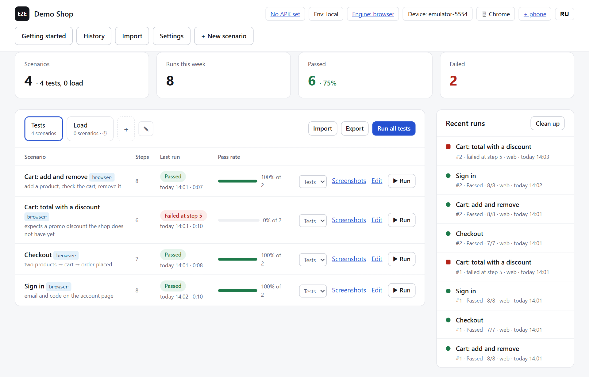
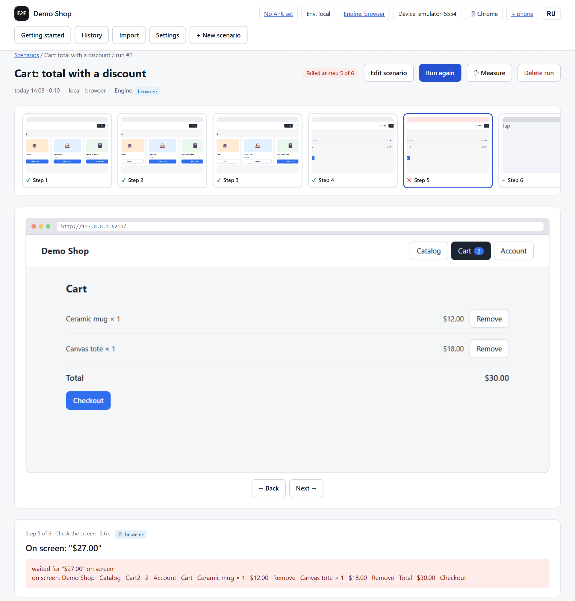

# E2E Console

[](https://github.com/SamuelBerrington/e2e-console/actions/workflows/ci.yml)
[](LICENSE)


[Русская версия](README.ru.md)

A local page for E2E runs of a mobile app on an emulator, a phone or an iOS simulator:
scenarios in YAML, a screenshot per step, backend checks from several accounts, the app's requests
and backend logs per step, comparison with Figma mockups and with baseline screenshots, a queue for several
devices. The console drives the screen with its own adb driver or with Maestro.

It knows nothing about a specific app: the package, the environment, the account login, the request envelope and the logs
are settings and plugins. It is convenient to keep your own project as a preset: one YAML with settings, blocks and
scenarios (see "Presets").





The screenshots show the browser engine on a made-up demo shop; on a phone or an emulator the frames are the app's screens.

## Getting started

```bash
npm install
node server.js
```

Open http://localhost:4777. An empty console opens on the **Getting started** page (`#/start`, also in the header):
a live checklist of five steps: adb and emulator found, a device connected (start an emulator by AVD or use "+ phone"),
the app known (the "Take from the device screen" button fills in the package and activity from what is open on the
device; the APK path and "Install APK"), a backend if you want one (API, roles, login plugin), the first scenario
(create one or import a preset). The same "Take from the device screen" button is in Settings. You need Node 20+ and
the Android SDK (adb, emulator). The console finds the SDK itself: `ANDROID_HOME` → `ANDROID_SDK_ROOT` → the standard folder of the
system (`%LOCALAPPDATA%\Android\Sdk`, `~/Library/Android/sdk`, `~/Android/Sdk`) → `adb` and `emulator` from PATH;
set your own path in settings (`adbPath`, `emulatorPath`). The Maestro engine needs the Maestro CLI
(`~/.maestro/maestro/bin` or PATH) and Java 17+ (the console looks for it in `~/.gradle/jdks`, in Android Studio and in the
system JDK folders on macOS and Linux). The "built-in (adb)" engine is the console's own driver on top of adb.

**Platform support.** The console was developed and verified on Windows. The macOS and Linux code paths (discovery of the
SDK, Java, Maestro and the browser, clipboard typing) are implemented but have not been run on a real machine. The iOS driver
was written without a Mac at hand.

## Scenario language

A scenario is YAML (the editor has a "YAML" mode; the form is for simple edits). Steps are short
(`- tap: Catalog`) or with fields. A full example is `examples/scenario-advanced.yaml`, the schema for the
editor is `schema/scenario.schema.json` (also `GET /api/schema`).

Targets in the samples (button captions, screen texts) stand for the texts of your own app's UI.

```yaml
name: Order delivery
vars: { product: demo-123 }
setup:                                   # goes first; if it fails, the main steps do not run
  - use: reset-cart
steps:
  - use: add-to-cart                     # a block with parameters
    with: { product: "{{product}}" }
  - use: checkout
  - if: { visible: Add details }    # the condition is checked once, when the run gets here
    then: [ { tap: Add details } ]
    else: [ { assertText: Main Street } ]
  - repeat:                              # until it holds / no more than N times
      until: { notVisible: Checking payment }
      max: 20
      steps: [ { wait: 2 } ]
  - api: { url: api/v1/orders, poll: 40, expectPath: items.0.status, expectValue: paid, save: { orderId: items.0.id } }
  - api: { url: "api/v1/courier/{{orderId}}/pickup", method: POST, auth: courier }
teardown:                                # always, except after "Stop"
  - api: { url: api/v1/cart/clear, method: POST }
matrix: { delivery: [Courier, Pickup] }   # one scenario × rows = several runs
rules: { noServerErrors: true }            # any 5xx for the app fails the run
```

| What | How to write it |
|---|---|
| Blocks | `blocks:` in the scenario or a shared library (`data/blocks/*.yaml`, "Settings → Block library"); `- use: name`, `with: {…}`; `params: [a, b]` or `params: { a: default value }` |
| Phases | `setup`, `steps`, `teardown`. Teardown also runs after a failure |
| Conditions | `- if: {…} then: […] else: […]`; any step can have `when: {…}`, including `repeat`, `use` and steps inside them; nested conditions add up (the step runs only if all of them hold). A condition is `visible`, `notVisible`, `var` (+ `equals` / `matches`), `platform`, `not`; an unknown key is a lint error |
| Repeat | `- repeat: { until: {…} \| times: N, max: N, steps: […] }` |
| API polling | `poll: 60` repeats the request until `expectPath`/`save` match. GET is polled even without `poll`, while POST/PUT/PATCH/DELETE are sent once unless `poll` is set explicitly |
| Matrix | `matrix: { a: [1, 2], b: [x] }` (all combinations) or a list of rows; row variables are `{{a}}` |
| Roles | `auth: <role>` on an API step; roles and their tokens/phone numbers are in settings (`accounts`); by default the account of the app itself (`auth.appAccount`), otherwise the first role in the table; `none` means no token; steps have `{{role.phone}}` |
| Screen checks | `assertText: { text, absent, regex, count, id }`; `assertScreen: { baseline, threshold }` compares with a baseline screenshot (the first run saves the baseline to `data/baselines`; on the run page you can accept a new one) |
| Step policy | on any step: `retry: N`, `optional: true` (a failure does not fail the run, the step is marked "with a caveat"), `flaky: true` (two attempts and a mark), `timeout`, `screenshot: false` |
| Platforms | `target: { android: Navigate up, ios: Back }` (also `text`, `url`); `when: { platform: ios }` |
| Substitutions | variables from settings and the scenario, `save` from API steps, `{{uuid}}`, `{{now}}`, `{{hex64}}`, templates from settings (`{{context}}`) |
| Measurement | `measure: true` or `measure: { iterations: 3, flashlight: false }`: frames, CPU and memory on every screen step, a score per run; see "Performance" |
| Scrolling | `swipe: { direction, fast: true, times: 10, pause, duration }`. `fast` is a sharp fling (80 ms across almost the whole screen), `times` is a series in a row: a load test for a list |
| Pinch | `pinch: { direction: out\|in, times, pause, duration }` — two fingers around the screen centre: `out` spreads them (zoom in, e.g. a feed switching grid → column), `in` brings them together. Android gets real multi-touch over adb (sendevent), the browser a Chromium gesture; Maestro and iOS cannot do it |
| Section | `section: Feed` is where the scenario lands in the performance history; without it, "Other" |
| Variants | `variants: { lite: { title, vars, setup, teardown } }`: one run per variant; the variant's `setup` goes before the scenario, `teardown` after it, `vars` are available as `{{…}}`; the history counts variants separately |
| Tabs | the main page has two tabs: scenarios with `measure` or the `perf` tag go to the "Load" tab, scenarios without `measure` or with the `tests` tag go to the "Tests" tab (one scenario can be in both); a run from "Load" always measures, "Measure all" queues the whole tab |

**Checks before a run.** The linter (on save, `GET /api/scenarios/<id>/lint`, `node tools/e2e.js lint all`)
catches unknown fields and types, undefined variables, nonexistent blocks and roles, and, using the last run,
`save`/`expectPath` fields that were not in the response. A scenario with errors does not run (`?force=1` runs it anyway).

## Performance

`measure: true` in a scenario (or the "⏱" button on a scenario, `--measure` on the command line) turns on measurement around
every screen step, for Android with the adb or Maestro engine. You do not need to add anything to the app: the console
reads the system's own counters through adb.

| What | Source | Why |
|---|---|---|
| **Frame cost** p50 / p95 | `dumpsys gfxinfo framestats`: UI thread (input, animation, layout, draw recording) + RenderThread without waiting for the buffer | how much CPU time the app spends per frame: a number that carries over from the emulator to phones |
| **Jank** | the share of frames costlier than a 60 fps frame (16.7 ms), one yardstick for all devices; next to it `jankHz`: costlier than the real screen interval (8.3 ms at 120 Hz) | "does it stutter" |
| **On screen** p95 · missed | the same framestats: from vsync to presentation, the share of missed deadlines | how it looked on this device; on the emulator it is limited by the host's video path, so it is not part of the score |
| **Startup** | `am start -W` TotalTime | cold start: process → first frame, measured by Android itself |
| **Transition** | from the frame that handled the tap to the end of the first series of frames | how long the screen kept moving after a tap or swipe |
| **CPU · RAM** | `/proc/<pid>/task/*/stat`, `/proc/<pid>/statm` before and after the step | CPU in fractions of one core, which threads used it; RSS |
| **Flashlight** | the [bamlab/flashlight](https://github.com/bamlab/flashlight) profiler alongside: CPU per thread, FPS from atrace, RAM | an independent 0–100 score by their formula |

**Score 0–100** (per run, over the steps of the main phase; setup/teardown do not count): half is the jank share
(0 % → 100, 30 % → 0), half is the p95 frame cost (≤ 8 ms → 100, ≥ 33 ms → 0). ≥ 85 is "smooth",
≥ 60 is "fine", lower is "laggy". The score describes the device the run was on; with fewer than 20 frames there is
no score. The main value is the history: the run page has a table by build with the median of the scenario's measurements
on each build and the spread (min–max). One measurement proves nothing: the noise between runs is 4–13 points
on a phone and up to 34 on an emulator, so a difference smaller than the spread is shown in grey as "within noise", and a comparison
with a single measurement is shown as "1 run". A colored Δ appears only when the change is larger than the spread.

`measure: { iterations: 3 }` queues three runs in a row, and their median goes into the build table.
To compare builds you need 3–5 iterations for each, otherwise the difference drowns in noise. A measurement series always goes to one device: with "any free" the device is chosen when the series starts, not
as the queue frees up, so that the iterations of one series do not scatter across the emulator and a phone. On the
"Load" tab a scenario with variants has a sub-row for each variant with its own last measurement, score and "⏱". `flashlight: false` turns off the Flashlight profiler (it is installed by `npm install` as
`@perf-profiler/profiler`, puts its binary into `/data/local/tmp` on the device and works entirely
locally: nothing is sent anywhere; the `flashlight cloud` command is not used by the console).

Not measured: iOS (for now), GPU load on the emulator (the host's graphics card), heating. Use the same
emulator image and a quiet host, otherwise the numbers drift. Compare builds, not absolute numbers.

**Emulator hygiene** (checked 2026-11-09 on an Android 16 emulator): after a day of uptime with snapshots
the emulator drew 5–13 frames per swipe at a frame cost of 110–200 ms; after `adb emu kill` and a cold start with
`emulator -avd <avd> -no-snapshot-load` it drew 55–75 frames per swipe and p50 was 7.6 ms on the same build. Before a series of
measurements: cold start, wait a minute after boot (startup services), keep `adb shell cat /proc/loadavg` below about 4,
and make sure no builds, indexing, Defender or updates are running on the host. `android.hardware.radio-service.ranchu`, which eats a whole
core, is a bug of the emulator itself: airplane mode and `gsm off` do not calm it down, only `adb root` + `stop vendor.radio-ranchu`
helps (the app and Wi-Fi keep working). For this, the "+ phone" page has a "Prepare for measurement"
button for the emulator: `adb root`, the commands from the `emulatorHygiene` setting (one per line), then load average and the guest's top.

**History and scores.** "History" in the header (`#/perf`, data from `GET /api/perf/summary`): for each device
(the emulator, each phone) and build there is a total "N of M", like benchmarks: the score of a scenario (and variant) is the median of its
passed measurements on this build, the score of a section (`section`) is the mean over its scenarios, the total is the sum of sections, so
the maximum grows with the number of sections, and a weak section shows up as a hole instead of being smeared into the average. Below is a
table by build with section scores and Δ against the previous build on this device: a regression is visible in the column. The
"Build comparison" block puts the selected build next to a base (the previous one by default): the total, the sections and every scenario with
score, p95, jank, startup, with the difference and the marks "new" / "not measured". The Δ of the total is computed only over the sections that
exist in both builds (otherwise ≠ stands next to it), so that an added section does not look like a regression. Every row links to the run report and can
measure the scenario (or a specific variant) again. Comparing makes sense only within one device and
one Flashlight mode. The spread stands next to the medians, and a Δ inside the spread is marked "within noise". A build is
versionName + versionCode + md5 of the installed APK (read from the device, about a second per run); runs
recorded before 2026-11-11 are grouped by APK file name, so the first new measurement of an old build starts
a new row. Runs without a score formula mark are recalculated from the saved frame statistics and marked "*".

**Phone and calibration.** "+ phone" in the header is a page for connecting over Wi-Fi (Android 11+): the pairing
code from the "Wireless debugging" dialog and the address; the console finds the connection port itself through mDNS,
and the phone is remembered in `devices`. Run the same perf scenario with measurement on the phone and press "Make the calibration reference" on its
page: the console takes the emulator run of the same scenario, the same variant
and the same installed build (and the same Flashlight mode, if there is one), computes K = p95 frame cost on the phone ÷ on the emulator (median over steps), recognizes the
phone's chip (`ro.soc.model` → `lib/chips.js`, ~70 chips with an approximate Geekbench 6
single-core score) and saves everything to `settings.perf`. From then on every emulator measurement has
a forecast: p95 on the reference = p95 from the emulator × K, on another chip proportional to the score, and two numbers,
"a chip of N points or better is needed" for "fine" (p95 ≤ 12 ms) and "smooth" (≤ 7 ms). If the chip is not in the table, the
console asks for the score; your own chips go in `settings.perf.chips: [{ code, name, score }]`.

The calibration remembers when and on what it was taken: the emulator image, both builds, the emulator's p95. The forecast is shown as
a number only while the calibration is fit for the run. Instead of numbers the console writes the reasons if the calibration is older than
14 days, its age or origin is unknown (an old record with only K), it was taken on another emulator
image, it compared different builds or variants, K is outside 0.1–3, or the scenario's p95 on the emulator moved by more than
a factor of two from the calibration value. Then the calibration has to be taken again. The forecast of old runs is recalculated against the
current calibration; its date is in the block header. The calibration response (and the CLI) reports `check`: whether
it will give forecasts. From the command line: `node tools/e2e.js calibrate <phone run id>`.

Caveats about Flashlight: its fps is computed from atrace and counts idle as 60, so "45 fps" from
Flashlight and 10 frames per swipe in our data do not contradict each other. Look at frame cost and
jank. Its profiler adds load itself (on an overloaded emulator about 20 % to frame cost), so for
a clean comparison of builds turn it off (`flashlight: false` or `--no-flashlight`) and
keep one mode across the whole history.

## Screen engines

Screen steps are executed by one of three engines. Choose it in settings and per scenario, or once:
`node tools/e2e.js run <id> --engine maestro`.

- **adb** is the console's own driver (uiautomator + `input`). It is faster and supports offset from an element and `count`. Non-ASCII input goes
  through the computer's clipboard, so it works on an emulator that mirrors it; on macOS `pbcopy` is needed,
  on Linux `wl-copy` or `xclip`.
- **Maestro**: consecutive screen steps go out as one flow (`data/runs/<id>/maestro/steps-N-M/flow.yaml`),
  and the report is laid back out per step. On iOS it is the only engine. Run variables are passed to Maestro
  through the environment (`MAESTRO_E2E_V*`), not on the command line: values with `&`, `|`, `%` are safe and do not
  end up in `flow.yaml`. The path to the Maestro CLI and the device serial must not contain `"` or `%`.
- **web** is a page in a browser through Playwright on top of an already installed Chrome or Edge (`playwright-core`
  is installed with the console, no browser is downloaded). The same steps as on a phone: "Open the app" opens
  an address (`url`, full or a path from "Site address" in settings), "Tap" and "Check the screen" look for the text of
  elements, a field label, a placeholder or an aria-label, "Type text" types into the field under the cursor (for `<select>` it
  picks the option by text), "Swipe" turns the wheel, "Back" goes through history. Before a tap the element is scrolled
  to the middle of its panel (pages often scroll an inner container rather than the window, and a button at the bottom edge
  would end up under a pinned bar); elements that the page has disabled are waited for up to `timeout`. A tap
  does not go "through": if the element is hidden, transparent, covered by another one or gone from the page after the snapshot, the step
  fails with an explanation instead of clicking whatever is there. `storage` on "Open the app" puts entries into localStorage before
  the page scripts run (only for the site from `url`, once): a ready session, flags; a redirect on the first load
  does not lose them. The page language is the `web.locale` setting (empty means the system language). Page requests (fetch/XHR) are shown on the step as app requests, and the
  `noServerErrors` rule counts them too. Headless by default; you can turn on a visible window in settings.

What Maestro lacks, the console does on top with any engine: backend checks from any roles, backend logs
and remarks on the app's requests, baseline screenshots, manual steps, Figma mockups, conditions and repeats.
Steps that Maestro cannot express are executed by adb when the Maestro engine is selected.

### Phone and browser in one scenario

The screen can be set for a part of the steps: a `browser: [...]` group runs its nested steps in the browser, `phone: [...]`
on the phone, `on: web` / `on: phone` switches a single step, and the `if` condition looks at the same place (`on` inside a condition
overrides it). A scenario with `engine: web` runs entirely in the browser and does not need a phone; a scenario with steps on
both screens takes the phone, opens the browser at its first step and closes it at the end of the run.

```yaml
steps:
  - use: checkout          # phone: the buyer places an order
  - browser:
      - launch: { url: /admin/orders, storage: { session: '{"accessToken":"{{buyer.token}}", …}' } }
      - input: { target: order_id, text: "{{orderId}}" }
      - tap: { target: Hand over to carrier, timeout: 120 }
  - use: open-order                   # the phone again
    with: { tab: Completed }
```

On the run page the screenshot strip is divided into "phone" / "browser" sections, browser frames are wide, and
an open browser step is shown as a window with a full-width address bar. Performance measurement does not
touch browser steps: it is about the app.

## List tabs

The scenario list is split into tabs. Out of the box there are two, "Tests" and "Load" (scenarios with `measure` or the
`perf` tag, with scores instead of pass rate), but you can have your own tabs: "+" next to them creates a new one, "✎" renames
or deletes the current one. A scenario is moved with the "Tab" selector in its row or in the editor; in YAML this is the field
`tab: <name or id>`. A scenario without `tab` lands by its type: measured ones in the first load tab,
the rest in the first regular tab. Tabs are stored in settings (`tabs`) and go into the export along with them.

## Devices and queue

Connected devices are adb (Android) and `xcrun simctl` (iOS simulators, macOS only). A run is put
in a queue and starts on a free device: the header has a selector "any / specific / all at once"
(`--device <serial>|all` in the CLI). On different devices runs go in parallel, on one device in turn.
The queue lives in the console's memory: after a restart, waiting and running runs are marked stopped with
a reason, and they have to be started again.
For iOS, `bundleId` is needed in settings; known devices can be described in `devices`
(`[{ serial, platform, name }]`). The iOS driver was written without a Mac at hand, so check it on the first run.

## Old runs and screenshots

Every run is its own folder in `data/runs`, a new run overwrites nothing, so the folder grows
(screenshots are almost all of its size). There are three ways to clean up:

- **Storage mode**: "Settings → Run rules → Screenshots of earlier runs" (`runs.screenshots`):
  `all` keeps everything (default); `latest`: a new run of a scenario deletes the screenshots of its earlier
  runs. Statuses, step timings, logs and measurement scores stay, so history and pass rate do not suffer.
  A run that did not start (no device) deletes nothing.
- **"Delete run"** on the run page: the whole run folder.
- **"Clean up"** above the "Recent runs" list: keep the latest one or five runs per
  scenario, delete anything older than a week, or delete only old screenshots. Before deleting, the console
  shows how many runs will go and how much space will be freed. Measurements are not deleted entirely: only their
  screenshots go, so the score history does not disappear. Running and waiting runs are not touched.

The same through the API: `DELETE /api/runs/<id>` and `POST /api/runs/prune` with the body
`{ keep, olderThanDays, what: "runs" | "screenshots", scenarioId, dryRun }`.

## Settings that make the console "yours"

| Setting | What it does |
|---|---|
| `appName` | the name in the header |
| `package`, `activity`, `bundleId`, `avd`, `apkPath` | the app and the device |
| `apiBase` | the API address for "Check the backend" steps |
| `accounts` | roles with any names: `{ buyer: { phone, otp, token }, seller: {…}, courier: {…} }`; the token is set by hand or through a login plugin. Renaming a role in the table keeps its refresh token. The old flat keys (`apiToken`, `sellerToken`, `refreshToken`…) are moved into `accounts` once on first start and removed from the file |
| `auth.plugin`, `auth.appAccount`, `autoToken` | the login plugin: a JS module with `freshToken()` that gives roles fresh tokens before a run (example: `examples/auth-plugin.js`); `appAccount` is the role the app itself is logged in as (a new login for it is done only by scenarios that clear data) |
| `templates` | named templates: `{{context}}` in a request body → the given JSON, `{{uuid}}`/`{{now}}` inside are new on every call |
| `vars` | `{{name}}` variables for steps |
| `appNet.tag` | the logcat tag where the app writes its HTTP requests; empty means off |
| `logs.*` | backend logs from VictoriaLogs in Kubernetes: `enabled`, `kubeconfig`, `namespace`, `service`, `port`, `filter` |
| `allowStatus`, `screenIgnore` | statuses tolerated by `noServerErrors`; screen areas the baseline does not compare |
| `figmaToken` | show the mockup frame next to the screenshot |

### Login plugin

```js
// auth.plugin: a path from the console folder or absolute; reread on every run
module.exports.freshToken = async ({ apiBase, role, phone, otp, refreshToken, allowMint, settings }) => {
  // ... login or refresh for the role ...
  return { accessToken, refreshToken };   // refreshToken is saved to accounts.<role> and comes back next time
};
```

If a new login would kick the app out of the same account, the plugin throws an error with `code: 'MINT_NOT_ALLOWED'`
(and `hint`, a text for the user) when `allowMint` is false.

## Formats: import and export

Import is the "Import" button or `node tools/e2e.js import <files or folder> [--mode …] [--replace] [--dry]`.
The format is detected automatically:

| Format | What is inside |
|---|---|
| Console YAML / JSON | a scenario, a list of steps or a `kind: e2e-console/bundle` bundle with `settings`, `secrets`, `scenarios` |
| Maestro flow | an `appId` header + `---` + commands. What the console understands becomes its steps, the rest becomes "Maestro commands" steps; `runFlow: file` is inlined, `runScript` files (.js) are stored in the step |
| `.env` | `APP_PACKAGE`, `BUNDLE_ID`, `API_BASE`, `AUTH_PLUGIN`, `APP_NET_TAG`, `FIGMA_TOKEN`, `<ROLE>_PHONE`, `<ROLE>_TOKEN`, `<ROLE>_REFRESH_TOKEN`, `ENGINE`, `MAESTRO_PATH`… go to settings (`examples/keys.env.example`), the rest to variables. Empty values overwrite nothing |

Export: for a scenario it is console YAML, JSON or Maestro (blocks expanded, conditions as `runFlow.when`, repeats as `repeat`,
API checks as `scripts/*.js`, zip); on the main page it is all scenarios and settings in one YAML, with keys or without.

What goes into a bundle:

- **Without keys**: only what makes sense on another machine: the app (`package`, `activity`, `bundleId`),
  the environment and API address, the engine, tabs, templates, run rules, role names (without numbers and tokens),
  variables that do not look personal, and the block library.
- **With keys**: the same plus the Figma token, whole roles (number, code, token, refresh token) and personal variables:
  those whose name looks like phone / otp / token / secret / password, and values that look like a phone number.
- **In neither**: paths on this machine (adb, emulator, APK, browser, kubeconfig, Maestro, Java), AVD,
  serial numbers and the device list, measurement calibration. An export with keys is not a backup of the machine.

Blocks travel in the bundle (`blocks:`): when exporting everything, the whole library; when exporting selected scenarios,
only the blocks they use. On import, blocks are merged by name: a new one is added, an identical one
is skipped, and one that differs from yours stays yours until you choose "replace" in the preview
(`--replace` in the CLI). Tabs from a bundle are also added to yours, not replacing them.

In the editor's YAML mode, saving is strict: an unknown key, an unclear step or a comment is an error with a line
number, and nothing is saved (such lines used to disappear silently). A scenario is stored as data, so
comments cannot be kept; move them to `description`.
An exported Maestro flow runs without the console: `maestro test flow.yaml -e API_BASE=… -e BUYER_TOKEN=… -e COURIER_TOKEN=…`.

## Presets

A preset is a `kind: e2e-console/bundle` bundle (usually without keys) plus a login plugin next to it; blocks travel in the bundle itself
or as a separate library file. To make one: "Settings" → "Export without keys". To install: "Import" → the file, or

```bash
node tools/e2e.js import ../my-preset/preset.yaml ../my-preset/blocks --replace
```

Do not copy blocks over `data/blocks/`: that would overwrite your own library.

## Language

The interface is in Russian and English: the "EN / RU" switch in the header, the choice is stored in the browser. Until a choice is made the interface follows the browser language: Russian for a Russian browser, English otherwise. All
interface strings are in `public/i18n.js`: the Russian text is the key, the English is the value; a string without
a translation stays Russian, so translations can be added gradually.

The server speaks English: step names, details, errors, linter remarks, API responses and the output of
`tools/e2e.js` are English, and in `run.json` they are stored in English, neutral to the interface language. In
Russian mode the interface translates them when showing, using patterns from the same `i18n.js` (`tt()`); a phrase without a pattern
is shown as is. Runs recorded in Russian before 2026-11-09 can be read in both modes: reverse patterns
are kept for them. The module also works in Node (`require('./public/i18n.js')`, language from `E2E_LANG`)
if you need to translate command-line output.

## A second console alongside

`node server.js --port 4778 --data data-bare` (or `PORT` / `E2E_DATA`) starts one more console with its own data folder.
An empty folder is a console "out of the box": no settings, scenarios or blocks, the way a person without
your imports sees it. `data*/` folders are not committed.

One data folder, one console: at startup the console puts `.console.lock` into it and will not start if a live console already
holds the folder (otherwise two would drive one phone and kill each other's runs). A lock left by a crashed console
is removed automatically.

A copy of settings with `autoToken` on is not a "safe sandbox": it refreshes refresh tokens, and for the
console the settings were copied from they stop working. For experiments on a copy, turn `autoToken` off or
move the fresh tokens back.

## Security

The console listens only on `127.0.0.1` and answers only to `127.0.0.1` / `localhost` addresses of its own port. API requests
from pages of other sites (and other localhost ports) are rejected by `Origin` / `Sec-Fetch-Site`, and the request body must be
`application/json`. The command line and `curl` send requests without `Origin` and pass. Do not expose the console to a network
(through a proxy or on a shared server): it has no login, and settings hold tokens and paths to programs that
it runs.

`settings.json` and `run.json` are written atomically (a temporary file and a rename). A corrupted `settings.json`
is not overwritten by the console: the API answers with an error and the reason, and the file has to be fixed by hand or restored.

## How it is built

- `data/scenarios/*.json` are scenarios; `data/blocks/*.yaml` is the shared block library.
- `data/runs/<id>/` is a run: `run.json`, `step-N.png`, `step-N.diff.png`, `logs.json`, `maestro/`.
- `data/baselines/<scenario>/<name>.png` are baseline screenshots.
- `data/settings.json` holds settings and keys. The whole `data/` is not committed.
- `lib/compile.js` expands blocks, phases, conditions and the matrix into a flat list of steps; `lib/lint.js` checks it;
  `lib/runner.js` executes it; `lib/maestro.js` and `lib/adb.js` are the engines; `lib/ios.js` is simctl.
- `lib/perf.js` is measurement: parsing `framestats` and `/proc`, per-frame statistics, the score; `lib/flashlight.js` +
  `lib/flashlight-worker.js` are the Flashlight profiler in a separate process and its report. The result is `perf` in
  `run.json` (per run) and `steps[].perf` (per step, with a sample of frame costs for aggregation).

## Command line

```bash
node tools/e2e.js list
node tools/e2e.js lint all
node tools/e2e.js run login cart-add --engine maestro --device all   # exit code 1 if anything failed
node tools/e2e.js run perf-feed --measure --iterations 3           # with measurement: score, p95, jank, startup in the output
node tools/e2e.js import examples/maestro --dry
node tools/e2e.js export cart-add --format maestro --out out/
node tools/e2e.js export all --out out/
```

The console defaults to `http://127.0.0.1:4777`; set another with `E2E_CONSOLE=http://127.0.0.1:4778`.
Switch flags (`--force`, `--measure`, `--no-flashlight`, `--replace`, `--dry`, `--secrets`) take no values,
so they can go anywhere; `run` without a scenario id is an error (exit code 2).

## Tests

`npm test` runs the unit and integration suites with Node's built-in test runner (`test/unit`, `test/integration`).
The browser-engine tests are skipped when no Chrome, Edge or Chromium is installed.

## Known limitations

- Stopping a run skips its teardown.
- `retry` and `optional` do not work inside `repeat`.
- Flashlight tends to die on the emulator in app variants that stub the network.
- The performance history treats every emulator image as one device.
- The run queue lives in memory and is lost on restart.

## Contributing and security

See [CONTRIBUTING.md](CONTRIBUTING.md) and [SECURITY.md](SECURITY.md).

## License

[MIT](LICENSE)
